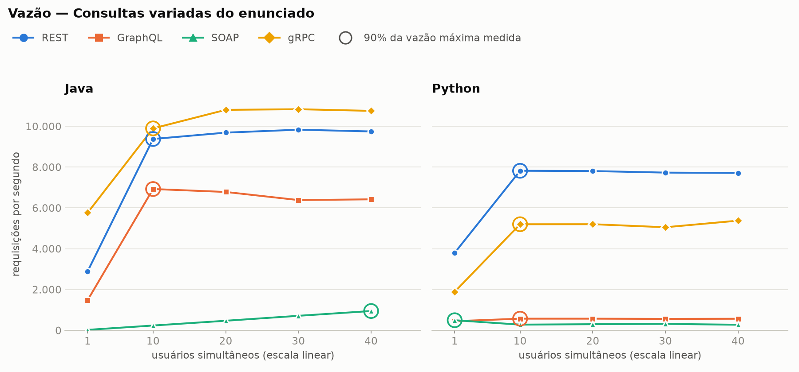
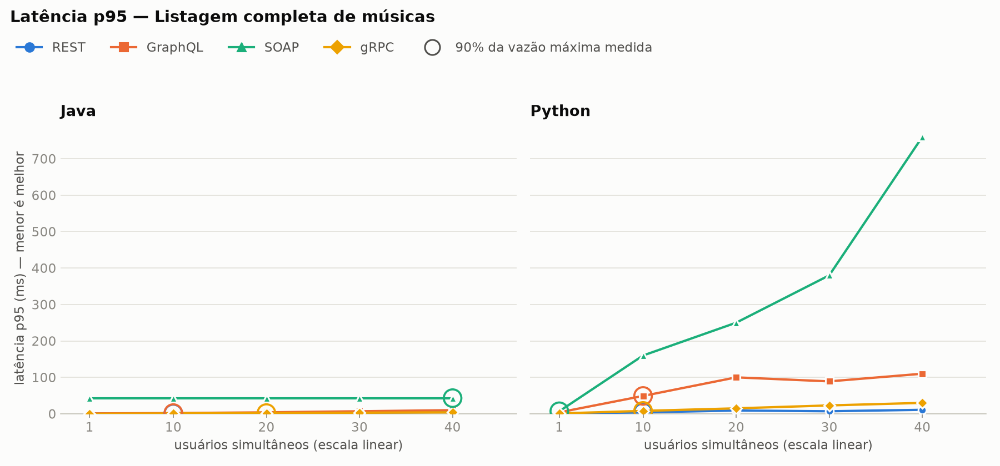
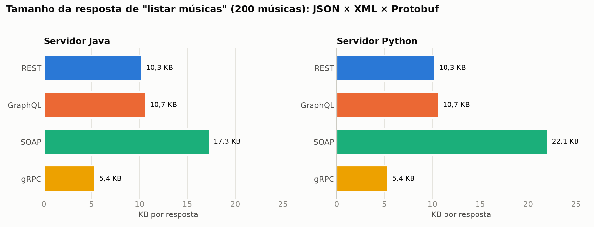

# Comparação de Tecnologias de Invocação Remota

Serviço de streaming de músicas implementado com **REST, GraphQL, SOAP e gRPC** em **Java e Python**, totalizando oito servidores equivalentes. O projeto inclui contratos compartilhados, teste funcional único para todas as implementações, benchmark comparável e gráficos em escala linear.

## Equipe

- Vinicius Costa - 2517259
- Ângelo Kauê - 2225671
- Vinicius Andrade - 2320419

## Escopo adotado

O projeto atende à parte prática do enunciado: CRUD de usuários, músicas e playlists, consultas relacionais, análise baseada na implementação e testes de carga. A pesquisa sobre origem, vantagens e desvantagens não foi incluída, conforme a orientação dada pelo professor em sala.

## Oito serviços comparáveis

| Tecnologia | Java | Porta | Python | Porta |
|---|---|---:|---|---:|
| REST | Spring Boot e Spring MVC | 8001 | FastAPI e Uvicorn | 9001 |
| GraphQL | Spring for GraphQL | 8002 | Ariadne e Uvicorn | 9002 |
| SOAP | Jakarta XML Web Services | 8003 | Spyne e Waitress | 9003 |
| gRPC | grpc-java e Netty | 8004 | grpcio | 9004 |

As duas linguagens usam as mesmas regras, os mesmos dados iniciais e os contratos de [`contratos/`](contratos/). Cada serviço começa com 100 usuários, 200 músicas e 200 playlists, com dez músicas por playlist.

## Operações implementadas

- CRUD completo de usuários, músicas e playlists.
- Listagem de todos os usuários e de todas as músicas.
- Playlists de um usuário.
- Músicas de uma playlist.
- Playlists que contêm uma música.
- Remoção em cascata das playlists quando o usuário é removido.
- Remoção da música de todas as playlists quando ela sai do catálogo.
- Erros equivalentes para recurso inexistente e entrada inválida.

## Estrutura

```text
.
├── contratos/       # schema GraphQL e arquivo Protocol Buffers compartilhados
├── java/            # projeto Maven com quatro serviços e módulo comum
├── python/          # quatro serviços e repositório comum em Python
├── testes/          # clientes, teste funcional e benchmark com Locust
├── resultados/      # CSVs, ambiente da medição e gráficos lineares
├── apresentacao/    # apresentação final
├── enunciado/       # PDF original do trabalho
├── Makefile
└── README.md
```

## Preparação

Pré-requisitos: Python 3.10 ou superior, Java 17 ou superior e Maven 3.8 ou superior.

```bash
make setup
make build-java
```

## Execução e teste funcional

Em um terminal, inicie os oito serviços:

```bash
make start
```

Em outro terminal, execute o mesmo roteiro funcional em todos:

```bash
make test
```

O teste percorre 17 etapas por serviço: CRUD, cinco consultas do enunciado, integridade dos relacionamentos e erros. As oito implementações passaram nesse roteiro.

## Testes de carga

O benchmark inicia um serviço por vez, faz aquecimento e mede quatro cenários:

- `consulta`: sorteio entre as cinco consultas do enunciado;
- `relacionamento`: músicas de uma playlist;
- `catalogo`: listagem completa das 200 músicas;
- `crud`: criação, consulta, alteração e remoção de um usuário.

Cada cenário usa **1, 10, 20, 30 e 40 usuários simultâneos**. Os gráficos usam escala linear nos dois eixos.

```bash
make benchmark
```

Para refazer apenas os gráficos usando os CSVs existentes:

```bash
make charts
```

A medição versionada contém 160 combinações de serviço, cenário e carga. Foram processadas **2.227.534 requisições sem falhas**. Os números descrevem estas implementações nesta máquina e não representam uma classificação universal dos protocolos.

## Principais resultados

Nas consultas variadas, as maiores vazões medidas foram 10.837 req/s para gRPC Java, 9.834 req/s para REST Java, 7.820 req/s para REST Python e 5.377 req/s para gRPC Python. GraphQL Python chegou a 572 req/s e SOAP Python a 496 req/s.

No catálogo com 40 usuários, o p95 foi de 4 ms para gRPC Java, 5 ms para REST Java, 11 ms para REST Python, 30 ms para gRPC Python, 110 ms para GraphQL Python e 760 ms para SOAP Python.

O gRPC produziu a menor resposta para listar 200 músicas, com 5,4 KB. REST usou 10,3 KB, GraphQL 10,7 KB e SOAP variou de 17,3 KB em Java a 22,1 KB em Python.

### Vazão em consultas variadas



### Latência p95 na listagem do catálogo



### Tamanho das respostas



Todos os gráficos e dados detalhados estão em [`resultados/`](resultados/).

## Entregáveis

- [Apresentação](apresentacao/Trabalho_6.pptx)
- [Enunciado](enunciado/Trabalho_6.pdf)
- [Resultados consolidados](resultados/resultados.csv)
- [Resultados por operação](resultados/resultados_operacoes.csv)
- [Carga de 90% da vazão máxima medida](resultados/saturacao.csv)
- [Descrição do ambiente](resultados/ambiente.txt)
- [Análise dos resultados](resultados/LEIA-ME.md)
